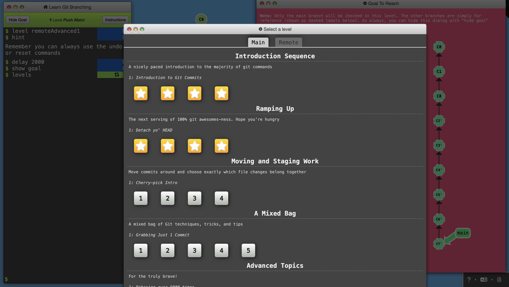
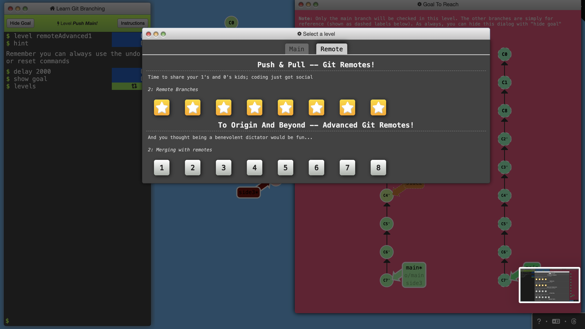

# Homework 2: Learn Git Branching

## Process

I completed all 16 required levels in the Introduction
Sequence, Ramping Up, and Push & Pull sequences.

I used ChatGPT to obtain guidance on the Git commands
and understand their functionality. I executed the
commands in Learn Git Branching and captured screenshots
of the completed sequences.

## Introduction Sequence

## Ramping Up

## Push & Pull -- Git Remotes!

